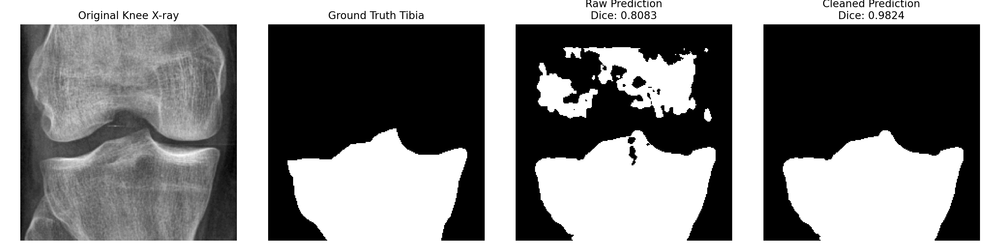
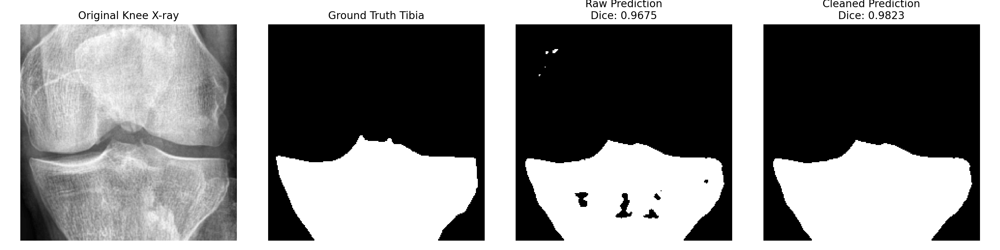
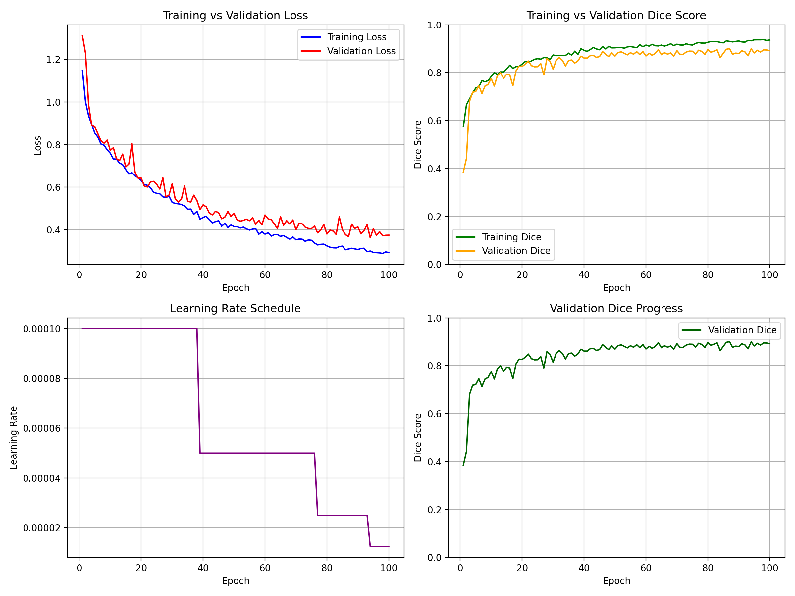
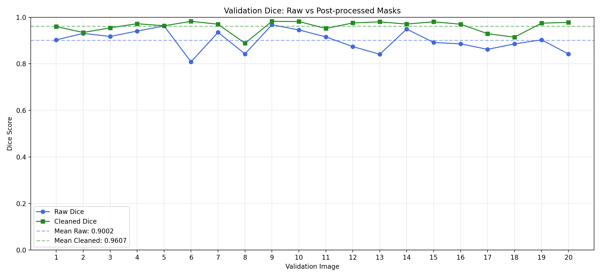

# Knee Image Segmentation Using U-Net

A deep learning project for **automatic tibia segmentation in knee X-ray images** using Python, PyTorch, and a U-Net Convolutional Neural Network (CNN).

The model generates binary segmentation masks to identify the tibia (lower knee bone). The project covers data preprocessing, training, evaluation, post-processing, and visualization.

## Results

| Metric | Result |
|---|---:|
| Dataset | 150 knee X-rays |
| Training / Validation / Test | 80 / 20 / 50 |
| Training epochs | 100 |
| Best raw validation Dice | **90.02%** |
| Post-processed validation Dice | **96.07%** |

Post-processing improved the mean validation Dice score by **6.05 percentage points**.

### Segmentation Examples

The following examples compare the original X-ray, ground-truth mask, raw prediction, and post-processed prediction.

**Example 1 — Dice: 0.8083 → 0.9824**



**Example 2 — Dice: 0.9675 → 0.9823**



## Dataset and Preprocessing

The dataset contains **150 grayscale knee X-rays**, resized to **256 × 256 pixels**.

| Split | Images | Ground-truth masks |
|---|---:|---|
| Training | 80 | Available |
| Validation | 20 | Available |
| Test | 50 | Not available |

Images are normalized to [0, 1], and masks are converted to binary values. Random horizontal flips and small rotations are applied during training.

The original dataset is not included in this repository.

## Model and Training

The model uses a compact **U-Net architecture** with two encoder blocks, a bottleneck, two decoder blocks, and skip connections. Each convolution block includes batch normalization and ReLU activation.

The network contains approximately **471,617 trainable parameters**.

| Configuration | Value |
|---|---|
| Framework | PyTorch |
| Optimizer | Adam |
| Learning rate | 0.0001 |
| Batch size | 4 |
| Epochs | 100 |
| Loss function | BCEWithLogits + Dice Loss |
| Weight decay | 0.00001 |
| Gradient clipping | 1.0 |
| Scheduler | ReduceLROnPlateau |
| Evaluation metric | Dice coefficient |

The model is validated after each epoch, and the checkpoint with the highest validation Dice score is saved as `sessions/demo_model.pth`.

### Training Performance



The best raw validation Dice score of **0.9002** was achieved at epoch 87.

## Evaluation and Post-Processing

The saved model is evaluated on **20 labeled validation images** using the Dice similarity coefficient.

Predicted probabilities are converted into binary masks using a threshold of **0.5**.

To improve segmentation quality, post-processing applies:

1. **Largest connected component:** Removes small, disconnected false-positive regions.
2. **Hole filling:** Fills enclosed holes inside the predicted tibia.
3. **Morphological closing:** Closes small gaps using a 3 × 3 elliptical kernel.

### Dice Score Comparison



| Prediction | Mean Validation Dice |
|---|---:|
| Raw | 0.9002 |
| **Post-processed** | **0.9607** |

All 20 validation images showed improved Dice scores after post-processing.

The trained model also generated masks for **50 unlabeled test images**. Since ground-truth masks are unavailable, quantitative test Dice scores cannot be calculated.

**Note:** Post-processing was developed using validation examples, so the reported cleaned Dice is a validation result, not an independent test result.

## Project Structure

```text
Knee-Image-Segmentation-with-CNNs/
├── args.py                 # Training parameters
├── data_preparation.py     # Dataset preparation and splitting
├── dataset.py              # Image loading and augmentation
├── model.py                # U-Net architecture
├── main.py                 # Training entry point
├── trainer.py              # Training and validation
├── utils.py                # Loss functions and Dice metrics
├── evaluate.py             # Evaluation and post-processing
├── README.md               # Project documentation
├── .gitignore              # Git exclusion rules
│
├── data/
│   ├── CSVs/               # Dataset split files
│   ├── masks/              # Ground-truth tibia masks
│   └── xrays/              # Knee X-ray images
│
└── sessions/
    ├── demo_model.pth
    ├── training_history.csv
    ├── training_curves.png
    ├── validation_dice_scores.csv
    ├── validation_dice_chart.png
    ├── postprocessing_dice_scores.csv
    ├── postprocessing_dice_comparison.png
    ├── validation_comparisons/
    ├── validation_comparisons_cleaned/
    ├── test_predictions/
    ├── test_predictions_raw/
    └── test_predictions_cleaned/
```

## Installation and Usage

**1. Clone the repository**

```bash
git clone https://github.com/Yasubst/Knee-Image-Segmentation-with-CNNs.git
cd Knee-Image-Segmentation-with-CNNs
```

**2. Install dependencies**

```bash
pip install torch numpy pandas matplotlib opencv-python scikit-learn
```

**3. Prepare the dataset**

Place the X-rays in `data/xrays/` and their corresponding masks in `data/masks/`.

```bash
python data_preparation.py
```

**4. Train the model**

```bash
python main.py
```

For a short five-epoch demonstration without overwriting the main checkpoint:

```bash
python main.py -epochs 5 -out_dir sessions/demo_5epochs
```

**5. Evaluate the saved model**

```bash
python evaluate.py -out_dir sessions
```

Evaluation generates validation Dice scores, comparison figures, and raw and post-processed test predictions.

**Note:** The dataset and trained checkpoint are not included in this repository. Evaluation requires a compatible locally trained checkpoint.

## Technologies

**Python · PyTorch · NumPy · Pandas · OpenCV · Matplotlib · Scikit-learn · Git**

## Limitations and Future Work

The project uses a relatively small labeled dataset. Post-processing assumes the tibia is the largest relevant connected region, and independent labeled test data is not available.

Future improvements include training with more annotated X-rays, exploring alternative segmentation architectures, and evaluating performance on independent datasets.

---

**Disclaimer:** This project is intended for educational and research purposes only. It has not been clinically validated and is not intended for medical diagnosis or patient care.