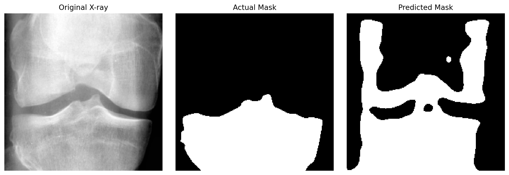
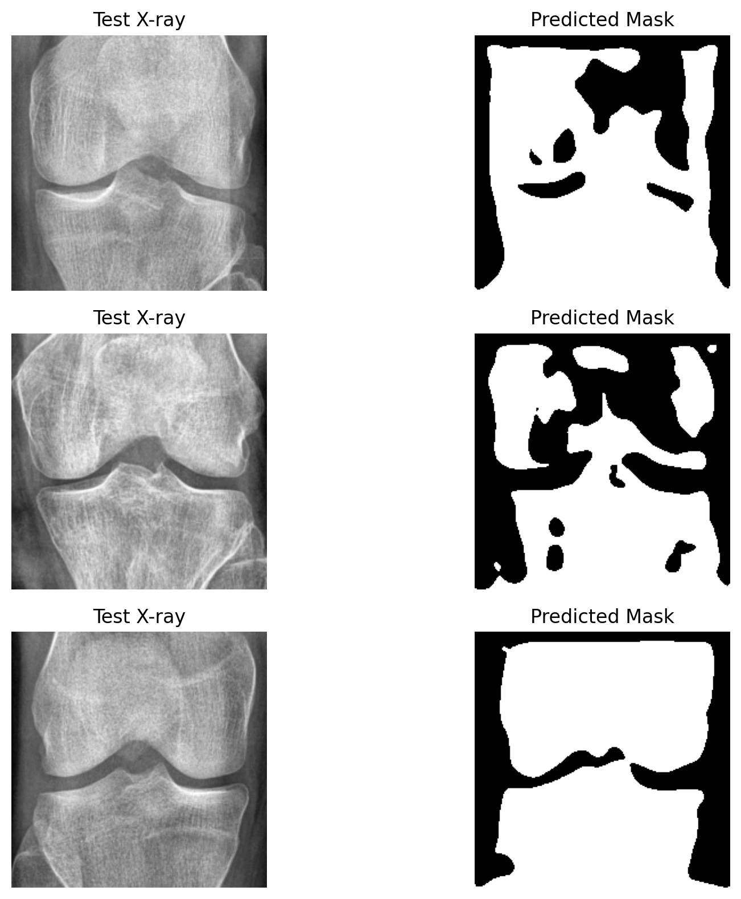

# Knee Image Segmentation Using U-Net

## Project Overview

This project implements a **U-Net Convolutional Neural Network (CNN)** for semantic segmentation of knee X-ray images using Python and PyTorch.

The main objective is to identify and segment the **tibia (lower knee bone)** by generating binary segmentation masks from grayscale X-ray images.

The project demonstrates a complete deep learning workflow, including data preparation, model development, training, evaluation, and visualization of segmentation results.

## Disclaimer

**This project is developed strictly for educational and research purposes.**

The model is designed to demonstrate medical image segmentation techniques and is **not intended for medical diagnosis, treatment decisions, or clinical use**.

The model has not undergone clinical validation, and its predicted segmentation masks may contain inaccuracies. Results should not be used for patient care or interpreted as professional medical assessments.

## Dataset

The dataset consists of **150 grayscale knee X-ray images**, processed at a resolution of 224 × 224 pixels.

| Dataset | Images | Ground-truth masks |
|---|---:|---|
| Training | 80 | Available |
| Validation | 20 | Available |
| Test | 50 | Not available |
| **Total** | **150** | **100 available** |

The training and validation images have corresponding binary segmentation masks indicating the target tibia region.

The dataset is excluded from this GitHub repository.

## Model Architecture

The project uses a U-Net architecture with an encoder-decoder structure and skip connections.

The architecture includes:

- **Encoder:** Two convolutional blocks for extracting image features.
- **Bottleneck:** A deeper convolutional block for learning high-level features.
- **Decoder:** Two upsampling blocks for reconstructing segmentation masks.
- **Skip connections:** Combine encoder and decoder features to preserve spatial information.
- **Output layer:** Produces pixel-level logits for binary segmentation.

The model has approximately **471,000 trainable parameters**.

## Training Configuration

The model was trained using PyTorch with the following configuration:

| Parameter | Value |
|---|---|
| Model | U-Net |
| Framework | PyTorch |
| Image resolution | 224 × 224 |
| Optimizer | Adam |
| Learning rate | 0.0001 |
| Batch size | 16 |
| Weight decay | 0.00001 |
| Loss function | Binary Cross-Entropy + Dice Loss |
| Training epochs | 30 |
| Gradient clipping | 1.0 |
| Evaluation metric | Dice similarity coefficient |

The training process includes validation after each epoch, and the best-performing model is saved as a checkpoint.

A separate five-epoch configuration is available for demonstrating the training process without overwriting the previously trained model.

## Model Evaluation

The saved model was evaluated using the **20 labeled validation images**.

The Dice similarity coefficient measures the overlap between predicted segmentation masks and ground-truth masks.

A Dice score of 1.0 indicates perfect overlap, while 0.0 indicates no overlap.

### Validation Results

| Prediction threshold | Validation Dice |
|---|---:|
| 0.30 | 0.5744 |
| 0.35 | 0.5818 |
| **0.40** | **0.5837** |
| 0.45 | 0.5743 |
| 0.50 | 0.5470 |

**Best validation Dice score: 0.5837 at threshold 0.40.**

The model achieved approximately 58.37% Dice overlap on the validation dataset.

The 50 test images do not have ground-truth segmentation masks. Therefore, quantitative test Dice scores cannot be calculated. Test images are used only for visual inspection of model predictions.

## Segmentation Results

### 1. Validation Segmentation

The following figure compares an original knee X-ray image, its ground-truth mask, and the model's predicted segmentation mask.



### 2. Test Image Predictions

The following figure demonstrates predicted segmentation masks for three previously unlabeled test X-ray images.



## Observations and Limitations

The model demonstrates the ability to learn segmentation patterns from knee X-ray images.

However, visual evaluation reveals several limitations:

- The model identifies portions of the tibia but does not consistently segment the complete target region.
- Some predictions incorrectly include areas around the femur or background.
- Certain predicted masks contain missing regions or irregular boundaries.
- The relatively small labeled dataset limits the model's ability to generalize.

The validation Dice score indicates that further improvements would be necessary before considering more demanding applications.

### Possible Future Improvements

Potential improvements include:

- Increasing the number of labeled training images.
- Applying data augmentation.
- Experimenting with alternative segmentation architectures.
- Tuning model hyperparameters and loss functions.
- Evaluating performance on additional labeled test data.

## Project Structure

```text
Knee-Image-Segmentation-with-CNNs/
│
├── args.py
├── data_preparation.py
├── dataset.py
├── model.py
├── main.py
├── trainer.py
├── utils.py
├── evaluate.py
│
├── demo_images/
│   ├── validation_prediction.png
│   └── test_predictions.png
│
├── README.md
├── .gitignore
│
├── data/                  # Local dataset (not included)
└── sessions/              # Local model checkpoints (not included)
```

### File Descriptions

| File | Purpose |
|---|---|
| `args.py` | Defines command-line training parameters |
| `data_preparation.py` | Creates training, validation, and test CSV files |
| `dataset.py` | Loads and preprocesses knee X-ray images and segmentation masks |
| `model.py` | Implements the U-Net architecture |
| `main.py` | Initializes the dataset, model, and training process |
| `trainer.py` | Handles training, validation, and checkpoint saving |
| `utils.py` | Contains Dice loss, Dice score, and other utility functions |
| `evaluate.py` | Evaluates the saved model and visualizes segmentation results |

## Installation and Usage

### 1. Clone the Repository

```bash
git clone https://github.com/Yasubst/Knee-Image-Segmentation-with-CNNs.git
cd Knee-Image-Segmentation-with-CNNs
```

### 2. Create a Virtual Environment

```bash
python -m venv .venv
```

Activate the environment on Windows:

```powershell
.venv\Scripts\activate
```

### 3. Install Dependencies

```bash
pip install torch numpy pandas matplotlib pillow
```

### 4. Prepare the Dataset

Place the knee X-ray images and segmentation masks in the local dataset directories expected by `data_preparation.py`.

Generate the dataset CSV files:

```bash
python data_preparation.py
```

### 5. Train the Model

```bash
python main.py
```

The default training configuration runs five epochs for demonstration purposes.

The reported validation results were obtained from a separately trained 30-epoch model.

### 6. Evaluate the Model

```bash
python evaluate.py
```

The evaluation script loads the previously trained checkpoint from:

```text
sessions/improved_model.pth
```

It calculates validation Dice scores and generates visual comparisons of predicted segmentation masks.

**Note:** The trained model checkpoint and dataset are not included in this repository. Evaluation requires a compatible locally trained checkpoint.

## Technologies Used

- Python
- PyTorch
- NumPy
- Pandas
- Matplotlib
- OpenCV (cv2)
- Git and GitHub

## Conclusion

This project demonstrates the implementation of a U-Net-based semantic segmentation pipeline for knee X-ray images.

The model achieved a best validation Dice score of **0.5837**, demonstrating partial segmentation capability while also highlighting the challenges of working with limited medical imaging datasets.

The project provided practical experience in image preprocessing, CNN architectures, training, evaluation, and visualization using PyTorch.

---

**Educational project only — not intended for clinical or diagnostic use.**